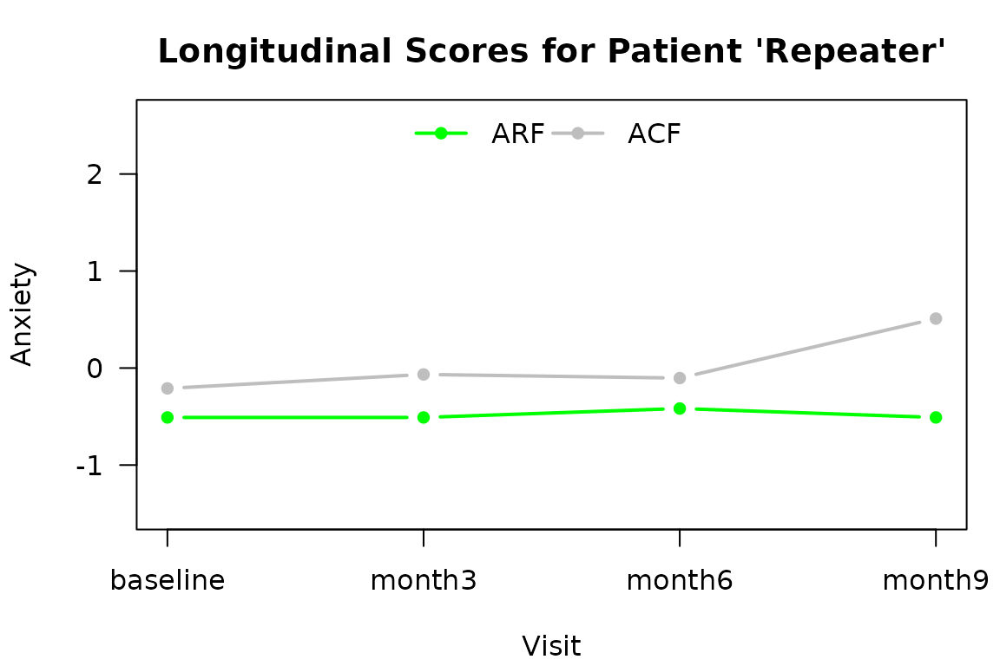

# scoreMVAQ

## The Michigan Vision-related Anxiety Questionnaire

The MVAQ (<https://www.ncbi.nlm.nih.gov/pmc/articles/PMC8184579/>) is a
14-item questionnaire to assess anxiety related to visual function among
patients with inherited retinal degeneration. A patient’s responses are
used to quantify visual function in 2 domains:

- Anxiety Related to Rod Function (ARF) and
- Anxiety Related to Cone Function (ACF).

The MVAQ itself is copyrighted material of the University of Michigan.
All rights reserved. For licensing information, contact the University
of Michigan Technology Transfer Office at `techtransfer@umich.edu`. This
scoring software is openly available.

## Scoring the MVAQ

A graded response model (GRM) was built from 128 original patients at
the University of Michigan. The R package mirt was used to fit the GRM
and can be used to score responses from new patients. The R package
scoreMVAQ contains the (deidentified) mirt model objects and a wrapper
function
[`scoreMVAQ()`](https://chrisandrewsphd.github.io/scoreMVAQ/reference/scoreMVAQ.md)
that uses 14 responses to generate 2 domain scores (and standard
errors).

### Installation

The scoreMVAQ package is available from GitHub. An easy way to install
scoreMVAQ is

``` r

# install.packages("devtools")
# devtools::install_github("ChrisAndrewsPhd/scoreMVAQ")
```

Installation is required the first time scoreMVAQ is used on a machine,
after a major version change of R (e.g. 4.2.1 to 4.3.0), or to obtain
the most recent version of the package.

### Examples from Package

The scoreMVAQ package has a few simple examples in the helpfile for
[`scoreMVAQ()`](https://chrisandrewsphd.github.io/scoreMVAQ/reference/scoreMVAQ.md)

``` r

library(scoreMVAQ)

# ?scoreMVAQ # open help file

example(scoreMVAQ) # run examples in help file
#> 
#> scMVAQ> justme <- read.table(
#> scMVAQ+   text = "Me,0,0,0,0,0,0,0,0,1,1,1,0,0,1",
#> scMVAQ+   sep = ",")
#> 
#> scMVAQ> scoreMVAQ(justme)
#> $thetas
#>   ID       ARF        ACF
#> 1 Me -0.168155 -0.8727335
#> 
#> $ses
#>   ID      ARF      ACF
#> 1 Me 0.117081 0.494362
#> 
#> 
#> scMVAQ> justyou <- data.frame(ID="You", matrix(nrow=1, sample(0:3, 14, TRUE)))
#> 
#> scMVAQ> scoreMVAQ(justyou)
#> $thetas
#>    ID       ARF     ACF
#> 1 You 0.4144947 0.71556
#> 
#> $ses
#>    ID      ARF       ACF
#> 1 You 0.152703 0.3146975
#> 
#> 
#> scMVAQ> names(justme) <- names(justyou) <- c("ID", sprintf("Q%0.2d", seq(14)))
#> 
#> scMVAQ> justus <- rbind(justme, justyou)
#> 
#> scMVAQ> scoreMVAQ(justus, verbose = 1)
#> i =  1 
#> i =  2 
#> $thetas
#>    ID        ARF        ACF
#> 1  Me -0.1681550 -0.8727335
#> 2 You  0.4144947  0.7155600
#> 
#> $ses
#>    ID      ARF       ACF
#> 1  Me 0.117081 0.4943620
#> 2 You 0.152703 0.3146975
```

### A Typical Use Case

The responses of an administration of the MVAQ should be stored in a
single row of a dataset. For example, in a cross-sectional study, each
patient has one row and 14 of the columns are the responses to the 14
items. In a longitudinal study, each patient visit has a row and 14 of
the columns are the responses. If the only columns in the data.frame are
an identifier and the 14 responses *in order*, then the function
[`scoreMVAQ()`](https://chrisandrewsphd.github.io/scoreMVAQ/reference/scoreMVAQ.md)
can be used with the dataset directly. However, it is often the case
that the data.frame contains additional columns that should not be
passed to
[`scoreMVAQ()`](https://chrisandrewsphd.github.io/scoreMVAQ/reference/scoreMVAQ.md),
such as VisitNumber, Sex, ExamDate, ….

#### Data Preparation

Read the data from a file and create a data.frame with 15 columns. The
first column is not used. It is carried along.
[`scoreMVAQ()`](https://chrisandrewsphd.github.io/scoreMVAQ/reference/scoreMVAQ.md)
does not reorder the rows. A generic approach could just use, e.g.,
seq(nrow(patientresponses)). In this example, The PatID and VisitID
variables are pasted to create the identifier

``` r

patientresponses <- read.csv(
  system.file("extdata/sampleMVAQ.csv", package = "scoreMVAQ", mustWork = TRUE))


dim(patientresponses) # has 61 columns (need 60)
#> [1] 11 16
patientresponses # Columns for PatID and VisitID
#>       PatID  VisitID MVAQ01 MVAQ02 MVAQ03 MVAQ04 MVAQ05 MVAQ06 MVAQ07 MVAQ08
#> 1      Best baseline      0      0      0      0      0      0      0      0
#> 2       One baseline      1      1      1      1      1      1      1      1
#> 3       Two baseline      2      2      2      2      2      2      2      2
#> 4     Worst baseline      3      3      3      3      3      3      3      3
#> 5      Miss baseline      4      4      4      4      4      4      4      4
#> 6  Repeater baseline      0      0      0      1      0      1      0      0
#> 7  Repeater   month3      0      0      0      1      0      1      0      0
#> 8  Repeater   month6      0      1      0      1      0      0      1      0
#> 9  Repeater   month9      2      2      1      1      0      1      0      0
#> 10      Han baseline      0      1      0      1      1      1      1      0
#> 11     Solo baseline      0     NA      0      0      0      0      1      0
#>    MVAQ09 MVAQ10 MVAQ11 MVAQ12 MVAQ13 MVAQ14
#> 1       0      0      0      0      0      0
#> 2       1      1      1      1      1      1
#> 3       2      2      2      2      2      2
#> 4       3      3      3      3      3      3
#> 5       4      4      4      4      4      4
#> 6       0      0      1      0      0      0
#> 7       0      0      1      0      0      1
#> 8       0      0      1      0      0      1
#> 9       0      0      1      0      0      1
#> 10      2      0      1      0      0      0
#> 11      1      1      0      0      0      0

dat_for_MVAQ <- data.frame(
  ID_Visit = paste(
    patientresponses$PatID,
    patientresponses$VisitID,
    sep = "|"),
  patientresponses[, seq(from = 3, by = 1, length = 14)])
dim(dat_for_MVAQ)
#> [1] 11 15
dat_for_MVAQ
#>             ID_Visit MVAQ01 MVAQ02 MVAQ03 MVAQ04 MVAQ05 MVAQ06 MVAQ07 MVAQ08
#> 1      Best|baseline      0      0      0      0      0      0      0      0
#> 2       One|baseline      1      1      1      1      1      1      1      1
#> 3       Two|baseline      2      2      2      2      2      2      2      2
#> 4     Worst|baseline      3      3      3      3      3      3      3      3
#> 5      Miss|baseline      4      4      4      4      4      4      4      4
#> 6  Repeater|baseline      0      0      0      1      0      1      0      0
#> 7    Repeater|month3      0      0      0      1      0      1      0      0
#> 8    Repeater|month6      0      1      0      1      0      0      1      0
#> 9    Repeater|month9      2      2      1      1      0      1      0      0
#> 10      Han|baseline      0      1      0      1      1      1      1      0
#> 11     Solo|baseline      0     NA      0      0      0      0      1      0
#>    MVAQ09 MVAQ10 MVAQ11 MVAQ12 MVAQ13 MVAQ14
#> 1       0      0      0      0      0      0
#> 2       1      1      1      1      1      1
#> 3       2      2      2      2      2      2
#> 4       3      3      3      3      3      3
#> 5       4      4      4      4      4      4
#> 6       0      0      1      0      0      0
#> 7       0      0      1      0      0      1
#> 8       0      0      1      0      0      1
#> 9       0      0      1      0      0      1
#> 10      2      0      1      0      0      0
#> 11      1      1      0      0      0      0
```

#### Scoring

The function
[`scoreMVAQ()`](https://chrisandrewsphd.github.io/scoreMVAQ/reference/scoreMVAQ.md)
returns a list with 2 elements. Each element is a data.frame with 3
columns: ID and the 2 domain scores. Each data.frame has the same number
of rows as the input.

``` r

MVAQlist <- scoreMVAQ::scoreMVAQ(dat_for_MVAQ, verbose = 0)
str(MVAQlist) # list with 2 elements
#> List of 2
#>  $ thetas:'data.frame':  11 obs. of  3 variables:
#>   ..$ ID : chr [1:11] "Best|baseline" "One|baseline" "Two|baseline" "Worst|baseline" ...
#>   ..$ ARF: num [1:11] -1.19713 -0.00306 0.44315 1.63047 NA ...
#>   ..$ ACF: num [1:11] -1.327 0.593 1.275 2.623 NA ...
#>  $ ses   :'data.frame':  11 obs. of  3 variables:
#>   ..$ ID : chr [1:11] "Best|baseline" "One|baseline" "Two|baseline" "Worst|baseline" ...
#>   ..$ ARF: num [1:11] 0.535 0.113 0.11 0.486 NA ...
#>   ..$ ACF: num [1:11] 0.614 0.242 0.227 0.475 NA ...

MVAQthetas <- MVAQlist[["thetas"]] # domain estimates
MVAQses <- MVAQlist[["ses"]] # standard error estimates
```

#### Wrap up

The
[`scoreMVAQ()`](https://chrisandrewsphd.github.io/scoreMVAQ/reference/scoreMVAQ.md)
output can be saved as an R object, written to an external file, used to
create summary data, plotted, …

``` r

patientthetas <- data.frame(patientresponses, MVAQthetas[, -1])
patientthetas
#>       PatID  VisitID MVAQ01 MVAQ02 MVAQ03 MVAQ04 MVAQ05 MVAQ06 MVAQ07 MVAQ08
#> 1      Best baseline      0      0      0      0      0      0      0      0
#> 2       One baseline      1      1      1      1      1      1      1      1
#> 3       Two baseline      2      2      2      2      2      2      2      2
#> 4     Worst baseline      3      3      3      3      3      3      3      3
#> 5      Miss baseline      4      4      4      4      4      4      4      4
#> 6  Repeater baseline      0      0      0      1      0      1      0      0
#> 7  Repeater   month3      0      0      0      1      0      1      0      0
#> 8  Repeater   month6      0      1      0      1      0      0      1      0
#> 9  Repeater   month9      2      2      1      1      0      1      0      0
#> 10      Han baseline      0      1      0      1      1      1      1      0
#> 11     Solo baseline      0     NA      0      0      0      0      1      0
#>    MVAQ09 MVAQ10 MVAQ11 MVAQ12 MVAQ13 MVAQ14          ARF         ACF
#> 1       0      0      0      0      0      0 -1.197130771 -1.32692104
#> 2       1      1      1      1      1      1 -0.003059503  0.59326736
#> 3       2      2      2      2      2      2  0.443153756  1.27527715
#> 4       3      3      3      3      3      3  1.630465525  2.62299468
#> 5       4      4      4      4      4      4           NA          NA
#> 6       0      0      1      0      0      0 -0.509326217 -0.20997665
#> 7       0      0      1      0      0      1 -0.509326217 -0.06599023
#> 8       0      0      1      0      0      1 -0.417189669 -0.10339904
#> 9       0      0      1      0      0      1 -0.509326217  0.50977036
#> 10      2      0      1      0      0      0 -0.207031906  0.09479659
#> 11      1      1      0      0      0      0 -0.215690843 -1.16805918

# save(
#   MVAQlist, dat_for_MVAQ, patientthetas,
#   file = "./example.RData")
# 
# write.csv(
#   MVAQthetas,
#   file = "./examplethetas.csv",
#   row.names = FALSE, na = "")
```

``` r

library(knitr)
library(kableExtra)

kableExtra::kable_styling(
  knitr::kable(
    sapply(
      subset(
        patientthetas,
        subset = VisitID == "baseline",
        select = names(MVAQthetas[, -1])),
      quantile, na.rm = TRUE),
    digits = 2,
    caption = "Summary of Baseline ARF and ACF"),
  full_width = FALSE)
```

|      |   ARF |   ACF |
|:-----|------:|------:|
| 0%   | -1.20 | -1.33 |
| 25%  | -0.36 | -0.69 |
| 50%  | -0.21 |  0.09 |
| 75%  |  0.22 |  0.93 |
| 100% |  1.63 |  2.62 |

Summary of Baseline ARF and ACF {.table .table
style="width: auto !important; margin-left: auto; margin-right: auto;"}

``` r

repeater <- subset(
  patientthetas,
  subset = PatID == "Repeater",
  select = c("VisitID", "ARF", "ACF"))

par(mar = c(4.1, 4.1, 3, 1), las = 1)
matplot(
  repeater[, c("ARF", "ACF")],
  type = "b", pch = 16, lty = 1, lwd = 2, col = c("green", "grey"),
  ylab = "Anxiety", ylim = c(-1.5, 2.6),
  xlab = "Visit", xaxt = "n",
  main = "Longitudinal Scores for Patient 'Repeater'")
axis(
  side = 1,
  at = seq(nrow(repeater)),
  labels = repeater$VisitID)
legend(
  "top", bty = "n", col = c("green", "grey"), lwd = 2, pch = 16,
  legend = c("ARF", "ACF"), ncol = 2)
```


